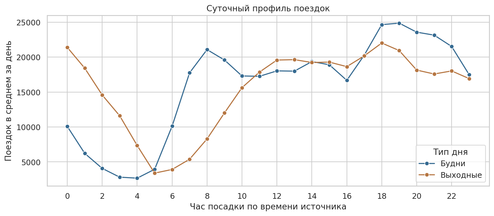
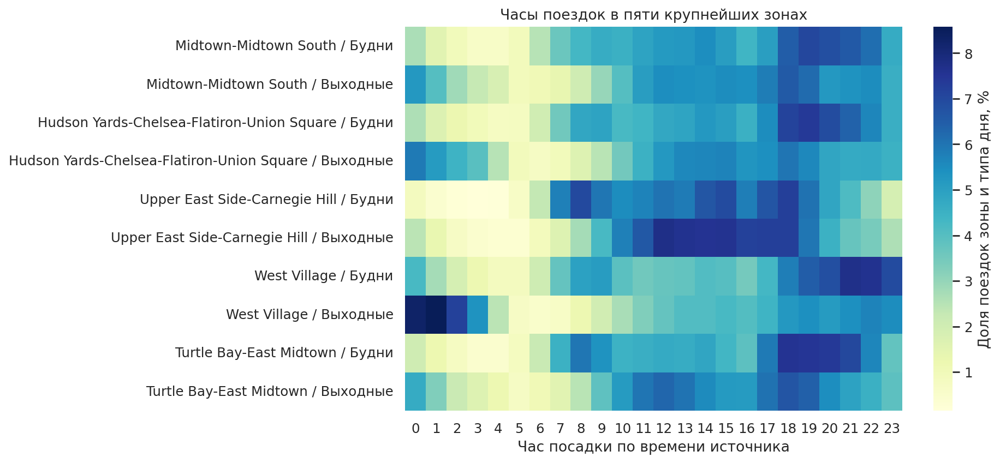

# ETL и отчетность по поездкам такси Нью-Йорка

Подготовка почасовой отчетности по желтому такси Нью-Йорка за январь-март 2016 года. Данные получены из публичного ClickHouse, преобразованы средствами SQL и Python и загружены в SQLite. Основной вопрос - как различается время пиковых поездок между зонами, буднями и выходными.

Полный процесс, выполненные ячейки и графики находятся в [taxi_reporting.ipynb](taxi_reporting.ipynb).

## Результаты

| Показатель | Значение |
| --- | ---: |
| Исходных строк в выбранном периоде | 68 999 718 |
| Уникальных сочетаний полей после удаления повторов | 34 499 856 |
| Поездок в отчетной выборке | 34 285 210 |
| Календарных дней | 91 |
| Строк почасовой витрины SQLite | 180 261 |
| Доля пяти крупнейших зон от всех учтенных поездок | 47,20% |

Общий час пика за квартал - 19:00 в будни и 18:00 в выходные. При этом различия зон существенны для выбора отчетных срезов:

- В West Village пик выходных приходится на 01:00 во всех трех месяцах. Доля поездок с 00:00 до 03:59 составляет 29,42% в выходные и 10,11% в будни.
- В Upper East Side-Carnegie Hill максимум выходных находится в диапазоне 12:00-15:00, а максимум будней - в 18:00.
- Общий пик выходных в марте приходится на 00:00. Один городской максимум скрывает различия районов и месяцев.

Будни и выходные сравниваются по среднему количеству поездок за календарный день соответствующего типа. В периоде 65 будних и 26 выходных дней. При ограничении длительности 6 часами вместо 24 общие часы пика сохраняются.





## Подготовка данных

| Этап | Реализация |
| --- | --- |
| Extract | Параметризованные запросы к ClickHouse по одному дню. В Python возвращаются агрегированные таблицы и отдельные дневные контроли |
| Transform | Удаление повторов, отбор записей и агрегация в SQL. Сверка дневных итогов и подготовка таблиц в pandas |
| Load | Замена выбранного периода в SQLite внутри транзакции. Проверка количеств, начислений и длительности до сохранения изменений |

Первый запрос объединяет записи по всем полям, кроме `trip_id`, и сохраняет число исходных копий. Второй запрос отдельно считает дневные количества и суммы. Проверка сопоставляет эти итоги напрямую. Оба запроса используют одно правило учета повторов.

В SQLite создаются три таблицы:

- `zone_hourly_report` - показатели по дате, часу и зоне посадки. Составной первичный ключ защищает детализацию.
- `daily_quality` - дневные количества исходных и уникальных записей по причинам отбора.
- `etl_runs` - журнал успешных загрузок.

В ноутбуке проверены повторная загрузка периода и откат при ошибочной вставке. Для сравнения читаются дневные итоги выбранного периода. Это проверка ключевых показателей, а не полного равенства всех полей. Сам отчет читает данные из SQLite и не обращается повторно к ClickHouse.

## Данные и правила учета

Источник - `default.trips` на [ClickHouse Playground](https://clickhouse.com/docs/get-started/sample-datasets/playground). Из таблицы выбрана категория `cab_type = 'yellow'`. Сохраненная выгрузка получена 2 ноября 2026 года. Период посадки - с 1 января 2016 года включительно до 1 апреля 2016 года. Даты и часы используются в том виде, в котором они представлены в источнике.

После удаления повторов последовательно исключаются несогласованные даты, неположительная или превышающая 24 часа длительность, неположительное расстояние и неположительная сумма. Одна запись получает одну причину исключения. Пустые названия зон сохраняются в группе «Не определено».

`pickup_ntaname` - название района из обогащенного набора ClickHouse, а не идентификатор современного справочника TLC Taxi Zones. `total_amount` - начисленная пассажиру сумма. Согласно [словарю TLC](https://www.nyc.gov/assets/tlc/downloads/pdf/data_dictionary_trip_records_yellow.pdf), она не включает наличные чаевые. Деньги хранятся в целых центах, средние показатели рассчитываются из сумм и количества поездок.

## Инструменты

Python, SQL, ClickHouse, SQLite, pandas, Seaborn, Matplotlib, Jupyter.

## Запуск

Нужен Python 3.12 или новее. В Windows можно использовать Python 3.13. Локальный сервер базы данных не требуется.

Распакуйте архив, откройте папку проекта в VS Code и выполните в PowerShell из ее корня:

```powershell
py -3.13 -m venv .venv
.\.venv\Scripts\python.exe -m pip install -r requirements.txt
```

Для Linux или macOS:

```bash
python3 -m venv .venv
.venv/bin/python -m pip install -r requirements.txt
```

Откройте `taxi_reporting.ipynb`, выберите ядро `.venv` и выполните ячейки сверху вниз. При `refresh_source = False` используется включенная выгрузка. После установки зависимостей этот режим работает без сети и обновляет SQLite и графики.

Для новой выгрузки установите `refresh_source = True`. Нужен доступ к `play.clickhouse.com` по HTTPS, порт `443`. Пользователь `explorer`, пароль пустой - опубликованные параметры публичного сервиса. Действуют ограничения на запросы. Ход выгрузки отображается одним индикатором прогресса.

Файл `source_info.csv` содержит период и время получения выгрузки. При изменении периода или SQL нужно заново получить данные с `refresh_source = True`. Проверка периода не позволит случайно использовать выгрузку с другими датами.

## Файлы

| Путь | Содержание |
| --- | --- |
| `taxi_reporting.ipynb` | Загрузка, проверки, подготовка витрины и отчет |
| `requirements.txt` | Зависимости Python |
| `data/source/zone_hourly_extract.csv.gz` | Агрегированная выгрузка |
| `data/source/source_control.csv` | Отдельно рассчитанные дневные контроли |
| `data/source/source_info.csv` | Период и время получения выгрузки |
| `data/taxi_reporting.sqlite` | Готовая база назначения, создаваемая ноутбуком |
| `assets/` | Графики |

Небольшая выгрузка оставлена для запуска без зависимости от доступности публичного сервера.

## Ограничения

Это исторический демонстрационный набор с собственным обогащением и повторами. Полностью одинаковые сочетания полей могут объединять физически разные поездки. Наличие записей за каждый день подтверждает покрытие дат, но не полноту регистрации всех поездок.

Зона неизвестна у 1,49% учтенных поездок. Начисления более 500 USD встречаются у 181 поездки и формируют 0,177% суммы `total_amount`. Их природа не установлена. Изменение месячных показателей не трактуется как причинный эффект или сезонность по трем месяцам.

Источник не содержит сведений о свободных машинах, неудовлетворенном спросе и ожидании пассажиров. Результат помогает выбрать срезы для разбора зарегистрированной нагрузки, но не устанавливает оптимальное количество машин.
